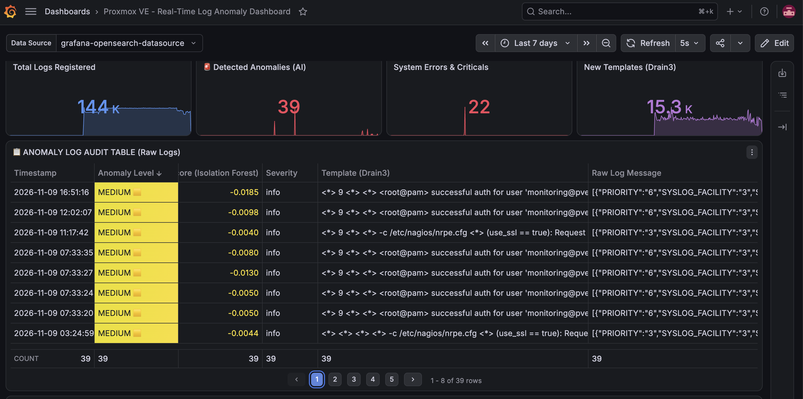
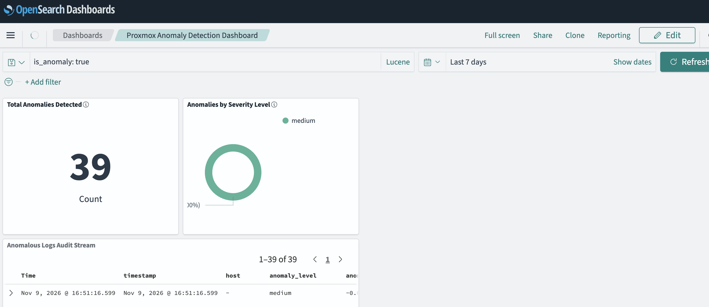

# Proxmox VE Real-Time Log Anomaly Detection

[](https://www.proxmox.com/en/proxmox-virtual-environment/overview)
[](https://www.python.org/)
[](https://fastapi.tiangolo.com/)
[](https://github.com/logpai/Drain3)
[](https://scikit-learn.org/)
[](https://vector.dev/)
[](https://opensearch.org/)
[](https://grafana.com/)
[](https://docs.docker.com/compose/)
[](https://www.gnu.org/licenses/agpl-3.0.en.html)

Real-time, AI-driven log anomaly detection architecture for Proxmox VE (PVE) clusters utilizing Vector, Drain3 template mining, Scikit-Learn Isolation Forest, OpenSearch, and Grafana.

---

## 1. Executive Overview

Managing large-scale [Proxmox VE](https://www.proxmox.com/en/products/proxmox-virtual-environment/overview) hypervisor clusters generates high-volume log streams daily across systemd journald, corosync cluster engine, PVE API proxies, ZFS storage sub-systems, and kernel events. Traditional rule-based alerting suffers from alert fatigue, high maintenance overhead, and an inability to detect zero-day or subtle multi-variable operational anomalies.

This project delivers an end-to-end, real-time observability pipeline that ingests raw log streams from Proxmox VE nodes, parses unstructured text into structured templates, extracts temporal and statistical feature vectors, scores anomalies using an unsupervised Isolation Forest model, and visualizes raw anomalous logs in Grafana with root-cause auditing capabilities.

### Key Highlights
* **Zero-Rule Maintenance**: Automatically learns normal cluster log patterns without manually writing rules.
* **Online Log Parsing**: Uses Drain3 fixed-depth parse tree to extract log templates and dynamic parameters on the fly.
* **Multi-Dimensional Anomaly Scoring**: Evaluates log length, parameter counts, severity levels, and 60-second sliding window temporal metrics (logs/min, errors/min, template volatility).
* **Graduated Anomaly Thresholds**: Categorizes events into `critical`, `high`, `medium`, and `normal`.
* **Raw Log Auditability**: Grafana dashboard focused on raw log inspection (`message`), allowing sysadmins to investigate exact log strings and root causes immediately.

---

## 2. Architecture & Pipeline Breakdown

The architecture follows a decoupled, containerized streaming pipeline designed for high throughput and low latency:

```
[ Proxmox VE Node ]
   └─ systemd-journald
        └─ Vector Agent (port 9000 gRPC)
                 │
                 ▼
[ Central Observability Server ]
   ├─ Vector Central Sink
   │     └─ HTTP POST /detect
   ├─ FastAPI Anomaly Detector (Python 3.12, Port 8000)
   │     ├─ Drain3 Log Parser (Template & Parameter Extraction)
   │     ├─ 9D Feature Vector Extractor (60s Sliding Window)
   │     ├─ Isolation Forest Classifier (Warm-up & Inference)
   │     └─ OpenSearch Bulk Ingestion Client
   ├─ OpenSearch (Storage & Search Engine, Port 9200)
   │     └─ Index: `logs-anomalies`
   └─ Grafana (Visualization & Root-Cause Auditing, Port 3000)
```

### Component Roles

* **[Vector](https://vector.dev/) Agent (Proxmox Node)**: Runs as a lightweight system service (`vector.service`), capturing `journald` entries (kernel, pveproxy, corosync, pvedaemon) and streaming them via gRPC to the central sink.
* **[FastAPI](https://fastapi.tiangolo.com/) Backend (`app`)**: A high-performance Python 3.12 service executing the dual-stage ML pipeline and batching output into OpenSearch via `_bulk` APIs.
* **[Drain3](https://github.com/logpai/Drain3) Template Miner**: Performs streaming log template extraction, separating static log structures from variable parameters.
* **[Isolation Forest Model](https://scikit-learn.org/stable/modules/generated/sklearn.ensemble.IsolationForest.html)**: An unsupervised machine learning algorithm (`n_estimators=200`, `contamination=0.05`) that isolates rare anomalies based on decision tree path lengths.
* **[OpenSearch](https://opensearch.org/)**: Stores enriched log documents containing raw messages, parsed templates, feature vectors, anomaly scores, and anomaly level flags.
* **[Grafana](https://github.com/grafana/)**: Serves dashboard `v1`, featuring real-time stat counters, anomaly score timelines, and raw log inspection tables.

---

## 3. Repository Structure

```text
.
├── app/
│   ├── Dockerfile
│   ├── drain3.ini
│   ├── main.py
│   ├── requirements.txt
│   ├── drain/                 # Auto-generated runtime state (drain_state.bin)
│   └── model/                 # Auto-generated ML model (isolation_forest.joblib)
├── dashboards/
│   └── grafana-dashboard-proxmox-v1.json
├── vector/
│   └── vector.yaml
├── docker-compose.yml
├── start-stack.sh
├── README.md
└── LICENSE
```

---

## 4. Machine Learning & Feature Engineering

The anomaly detection engine relies on a 9-dimensional feature vector calculated for every incoming log message:

### 9D Feature Vector Specifications

| Feature Name | Type | Description |
| :--- | :--- | :--- |
| `log_length` | Float | Character length of the raw log message. |
| `template_size` | Float | Number of active logs associated with the mined Drain3 template. |
| `parameter_count` | Float | Number of variable parameters extracted from the log message. |
| `severity` | Float | Mapped numeric severity (0=debug, 1=info, ..., 4=error, 5=critical, 6=alert, 7=emerg). |
| `logs_per_minute` | Float | Total log volume generated across the cluster within a 60-second sliding window. |
| `errors_per_minute` | Float | Volume of error/critical logs within the 60-second window. |
| `warnings_per_minute` | Float | Volume of warning logs within the 60-second window. |
| `unique_templates_per_minute` | Float | Count of distinct Drain3 log templates seen in the last 60 seconds. |
| `current_template_per_minute` | Float | Frequency of the specific log template within the last 60 seconds. |

### Model Lifecycle & Training Strategy

1. **Warm-up Phase**: During the first 300 logs (`WARMUP_SIZE = 300`), the system collects baseline features without marking false positives.
2. **Model Fitting**: Upon reaching 300 samples, an Isolation Forest model is trained and persisted to `/app/model/isolation_forest.joblib`.
3. **Inference Mode**: Subsequent logs are evaluated instantaneously against the persisted model.
4. **Graded Anomaly Classification**:
   * **Critical (Red)**: `anomaly_score < -0.20`
   * **High (Orange)**: `-0.20 <= anomaly_score < -0.10`
   * **Medium (Yellow)**: `-0.10 <= anomaly_score < 0.0`
   * **Normal (Green)**: `anomaly_score >= 0.0`

---

## 5. Proxmox Anomaly Battery (4 Validation Scenarios)

The detection engine has been validated against 4 critical Proxmox operational failure modes:

1. **Corosync Cluster Split-Brain**: Loss of totem quorum and failed cluster communication (`critical`).
2. **PVEProxy Brute Force**: Repeated authentication failures on port 59000 (`high`).
3. **ZFS I/O Fault**: Drive read errors and degraded pool status (`critical`).
4. **Out-of-Memory (OOM) Killer**: Kernel terminating `pve-ha-crm` or `kvm` processes (`critical`).

---

## 6. Deployment Guide

### Prerequisites
* Proxmox VE hypervisor nodes.
* Docker Engine & Docker Compose on the central management server.
* Network access between PVE nodes and central server on port 9000 (Vector) and port 8000 (FastAPI).

### Step 1: Deploy Central Stack
Clone the repository and start the stack using the provided helper script:

```bash
git clone git@github.com:username/proxmox-log-anomaly-detection.git
cd proxmox-log-anomaly-detection
chmod +x start-stack.sh
./start-stack.sh
```

### Step 2: Configure Vector Agent on Proxmox VE Nodes
[Install Vector](https://vector.dev/docs/setup/installation/package-managers/apt/) on each PVE host and configure `/etc/vector/vector.yaml`:

```yaml
sources:
  journal_pve:
    type: "journald"

sinks:
  enviar_al_central:
    type: "http"
    inputs:
      - "journal_pve"
    uri: "http://SERVER_IP:9000"
    encoding:
      codec: "json"
```

Enable and start the service:
```bash
systemctl restart vector
systemctl status vector
```

### Step 3: Import Grafana Dashboard
1. Open Grafana at `http://localhost:3000` (Default credentials: `admin`/`admin`).
2. Add OpenSearch Data Source:
   * **Name**: `OpenSearch`
   * **Plugin ID**: `grafana-opensearch-datasource`
   * **URL**: `http://opensearch:9200`
   * **Index name**: `logs-anomalies`
   * **Time field name**: `timestamp` (without `@`)
   * **Version**: `2.x`
3. Go to **Dashboards -> Import**, upload `dashboards/grafana-dashboard-proxmox-v1.json`, and select the OpenSearch data source.

---

## 7. Testing & Synthetic Anomaly Injection

To verify real-time ingestion and dashboard alerts without disrupting your cluster, inject synthetic test logs directly into the FastAPI endpoint:

```bash
cat << 'EOF' > test-anomaly.json
[
  {
    "message": "corosync: [TOTEM ] A processor failed, forming new configuration. Quorum lost!",
    "severity": "crit"
  },
  {
    "message": "pveproxy: authentication failure for user root",
    "severity": "error"
  }
]
EOF

curl -X POST "http://localhost:8000/detect" \
     -H "Content-Type: application/json" \
     -d @test-anomaly.json
```

Check the **Raw Log Audit Table** in Grafana under the **Last 5 minutes** view to observe real-time anomaly detection.

---

## 8. Acknowledgments & Collaborators

* **Gemini Notebook**: AI collaborative partner for pipeline architecture, feature engineering, dashboard design, and documentation co-creation.

---

## 9. Screenshots





---

## 10. License

Distributed under the Affero GPL v3 License. See [LICENSE](https://github.com/fv3rdugo/proxmox-log-anomaly-detection/blob/main/LICENSE) for more information.
